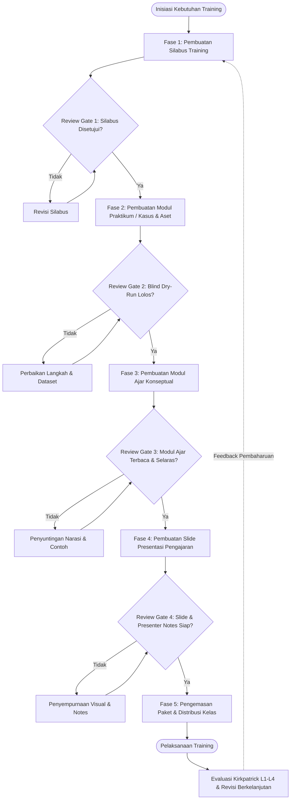

# STANDAR OPERASIONAL PROSEDUR (SOP) WORKFLOW PEMBUATAN MATERI TRAINING
## Panduan Operasional Pembuatan Silabus, Modul Praktikum/Kasus, Modul Ajar, dan Slide Presentasi
**Model Tim Lean / Instruktur Mandiri dengan Pendekatan AI-Assisted & Continuous Peer-Review**

---

## 1. PENDAHULUAN & ARSITEKTUR WORKFLOW

### 1.1 Tujuan Dokumen
Dokumen ini menetapkan alur kerja baku (*Standard Operating Procedure*) untuk merancang, mengembangkan, dan memvalidasi paket materi pelatihan yang profesional, berdampak nyata terhadap kinerja peserta, dan siap diaudit. 

SOP ini dirancang khusus untuk **Tim Mandiri / Lean** (di mana satu orang Instruktur/Trainer merangkap peran sebagai perancang kurikulum, penyusun materi, dan perekayasa praktikum) dengan memanfaatkan **AI sebagai akselerator kerja (*Co-Pilot*)** dan **Continuous Peer-Review** sebagai benteng kendali mutu.

### 1.2 Fondasi Desain Instruksional Internasional
Workflow ini mengintegrasikan standar dan teori desain instruksional terbaik dunia:
1. **Backward Design / Understanding by Design (Wiggins & McTighe)**: Perancangan dimulai dari hasil akhir yang diinginkan dan penetapan instrumen bukti evaluasi sebelum menyusun konten ajar.
2. **Taksonomi Bloom Revisi & Taksonomi SOLO**: Penjenjangan capaian pembelajaran pada ranah Kognitif, Psikomotor, dan Afektif secara terukur.
3. **Cognitive Load Theory (John Sweller)**: Manajemen kapasitas memori kerja peserta melalui teknik *chunking*, *scaffolding*, dan eliminasi *split-attention effect*.
4. **9 Peristiwa Instruksional Gagné & 5 Prinsip Merrill**: Standar struktur penyajian bab modul ajar berbasis masalah dan *worked examples*.
5. **Kerangka Diátaxis (Daniele Procida)**: Pemisahan tegas antara praktikum orientasi belajar (*Tutorial*) dan praktikum orientasi tugas kerja (*How-To Guide*).
6. **Skillable Instructions Writing Best Practices**: Standar rekayasa instruksi laboratorium teknis berbasis hierarki *Exercise -> Task -> Step* dan formula *Where, What, Why*.
7. **Standar Pelatihan Berbasis Kompetensi (SKKNI Kemnaker)**: Keselarasan materi dengan Unit Kompetensi, Elemen, dan Kriteria Unjuk Kerja industri.
8. **Model Evaluasi Empat Tingkat Kirkpatrick**: Integrasi metrik keberhasilan pascapelatihan (L1 *Reaction*, L2 *Learning*, L3 *Behavior*, L4 *Results*).

---

### 1.3 Matriks Peran 4 Artefak Materi Pelatihan

| Dimensi | 1. Silabus Training | 2. Modul Praktikum / Lembar Kasus | 3. Modul Ajar Training | 4. Slide Presentasi |
| :--- | :--- | :--- | :--- | :--- |
| **Fungsi Utama** | Cetak biru (*blueprint*), kontrak belajar, target capaian, dan matriks jadwal sesi | Panduan eksekusi langkah nyata untuk membentuk keterampilan psikomotor/aplikatif | Bahan bacaan konsep mandiri (*self-contained*), skema logika, dan *worked examples* | Alat bantu visual instruktur untuk memandu interaksi, ritme kelas, dan transisi |
| **Fokus Peserta** | Memahami peta jalan, sasaran, dan standar kelulusan (*Where & Why*) | Melakukan aksi langsung dan memverifikasi hasil kerja (*Hands-on Action*) | Memahami alasan di balik konsep dan mendalami teori (*Deep Understanding*) | Menangkap intisari konsep dan fokus pada instruksi verbal kelas |
| **Metodologi** | Backward Design, Bloom, SKKNI | Diátaxis, Skillable Standards, Problem Solving | 9 Gagné, 5 Merrill, Cognitive Load Theory | Mayer's Multimedia Principles, Visual Chunking |
| **Format Standar** | Google Docs / PDF (Tabel Matriks) | Google Docs + Repositori Aset (Data/Kode) | Google Docs / PDF Lengkap Bab per Bab | Google Slides (16:9 Landscape) |

---

### 1.4 Diagram Alur Handoff Urutan Kerja (Sequential Handoff Chain)

Berbeda dengan cara konvensional yang menyusun teori terlebih dahulu, urutan pembuatan dalam workflow ini mengikuti prinsip **Backward Development**:



**Logika di Balik Urutan Handoff:**
1. **Silabus** wajib disahkan pertama kali sebagai acuan batas ruang lingkup (*scope lock*).
2. **Modul Praktikum / Kasus** dibuat kedua karena tugas praktik adalah pembuktian langsung dari evaluasi silabus. Kita tidak bisa menulis modul ajar sebelum mengetahui persis tugas praktikum apa yang harus diselesaikan peserta.
3. **Modul Ajar** ditulis ketiga untuk memberikan teori, analogi, dan *worked examples* yang tepat sasaran mendukung modul praktikum (mencegah menulis materi teoretis yang mubazir).
4. **Slide Presentasi** dibuat terakhir sebagai ringkasan visual yang memadukan narasi modul ajar dengan tahapan eksekusi modul praktikum.

---

## 2. TATA KELOLA TIM LEAN & CONTINUOUS PEER-REVIEW

### 2.1 Alokasi Peran
Dalam model Tim Mandiri / Lean, terdapat 2 aktor utama:
1. **Lead Trainer / Creator (Pembuat Utama)**: Bertanggung jawab melakukan riset materi, merekayasa prompt AI, menulis draf dokumen, menguji sampel teknis, dan mengemas artefak.
2. **Peer Reviewer (Rekan Sejawat / QA)**: Rekan instruktur, rekan trainer, atau kurikulum specialist yang bertugas melakukan penelaahan independen, menjalankan pengujian buta (*blind dry-run*), dan memberikan persetujuan (*sign-off*) di setiap gerbang.

### 2.2 Aturan Continuous Review
Setiap dokumen **wajib lulus Quality Gate** sebelum Lead Trainer melangkah ke fase pembuatan dokumen berikutnya. Ulasan dilakukan menggunakan fitur **Komentar Google Docs** dengan batas waktu respons maksimal 1x24 jam per gerbang agar alur kerja tetap lincah.

---

## 3. FASE 1: WORKFLOW PEMBUATAN SILABUS TRAINING

### 3.1 Prosedur Operasional Langkah Demi Langkah

#### Langkah 1.1: Analisis Kebutuhan & Profil Peserta (TNA)
1. Identifikasi sasaran dampak bisnis/organisasi atau target karier peserta (Kirkpatrick Level 4) dan perilaku kerja nyata yang harus ditampilkan (Kirkpatrick Level 3).
2. Petakan profil peserta: latar belakang pendidikan/keahlian, pengetahuan awal (*prior knowledge*), dan asumsi kendala teknis.
3. Petakan unit kompetensi industri (SKKNI Kemnaker atau standar kompetensi relevan).
4. Terapkan filter **Model 3 Lingkaran (Wiggins & McTighe)**:
   - *Lingkaran Dalam (Enduring Understandings)*: Pola pikir dan prinsip dasar yang wajib diingat seumur hidup.
   - *Lingkaran Tengah (Important to Know and Do)*: Prosedur kerja dan keterampilan operasional utama.
   - *Lingkaran Luar (Worth Being Familiar With)*: Wawasan pelengkap yang cukup dibaca sekilas.

#### Langkah 1.2: Perumusan Capaian Pembelajaran Terukur (Learning Outcomes)
1. Tulis tujuan pembelajaran menggunakan format **SMART** (*Specific, Measurable, Achievable, Relevant, Time-bound*).
2. Gunakan **Kata Kerja Operasional Taksonomi Bloom / SOLO** yang terukur pada 3 domain:
   - **Kognitif**: hindari kata "memahami" atau "mengetahui". Gunakan kata kerja aktif seperti *menganalisis, mendiagnosis, merancang, membandingkan, mengkalkulasi*.
   - **Psikomotor**: gunakan kata kerja teknis seperti *menginstal, mengonfigurasi, menulis skrip, merekonstruksi, memodifikasi, menguji*.
   - **Afektif**: tetapkan sikap kerja profesional seperti *ketelitian kode, kepatuhan keamanan data, empati komunikasi, ketahanan dalam troubleshooting*.

#### Langkah 1.3: Desain Asesmen & Bukti Kelulusan (Backward Planning)
1. Rancang **Asesmen Sumatif (Proyek Akhir)**: Skenario kasus komprehensif di sesi penutup yang merefleksikan tantangan dunia kerja nyata.
2. Rancang **Asesmen Formatif (Misi / Tantangan Sesi)**: Latihan evaluasi mandiri di tiap sesi untuk mendeteksi kesenjangan belajar secara dini.
3. Susun rubrik penilaian dan persentase bobot kelulusan (contoh: 20% Keaktifan & Sikap, 30% Misi Formatif Mingguan, 50% Proyek Akhir).

#### Langkah 1.4: Penyusunan Matriks Sesi & Audit Keselarasan (WHERETO)
1. Susun matriks sesi ke dalam tabel standar:
   - *Kolom: Nomor Sesi | Fokus Topik | Sasaran Belajar (K/P/A) | Pokok Bahasan | Metode Pengajaran | Bentuk Evaluasi/Tantangan | Durasi*.
2. Lakukan *chunking* durasi: pecah sesi panjang menjadi blok 10-15 menit (paparan konsep pendek diselingi demonstrasi, tanya jawab interaktif, atau latihan mikro).
3. Jalankan audit **Segitiga Keselarasan Instruksional**: pastikan setiap Capaian Pembelajaran memiliki instrumen evaluasi yang sepadan, dan setiap aktivitas kelas mendukung langsung penyelesaian evaluasi tersebut.

---

### 3.2 Dual-Track Branching Silabus

```
[Kebutuhan Training]
       |
       +---> [Track A: Teknis IT / Data / AI]
       |     * Unit Kompetensi: SKKNI Software Development / AI / Data Analytics
       |     * Asesmen Sumatif: Repositori Aplikasi / Proyek Analisis Data Berjalan
       |     * Prasyarat: Spesifikasi Hardware, OS, Text Editor, dan Bahasa Pemrograman
       |
       +---> [Track B: Non-Teknis / Manajerial / Soft Skills]
             * Unit Kompetensi: SKKNI MSDM / Manajemen Proyek / Komunikasi Bisnis
             * Asesmen Sumatif: Simulasi Kasus Bisnis / Presentasi Proposal / Rekaman Roleplay
             * Prasyarat: Pemahaman Konteks Bisnis, Studi Kasus Industri, Formulir Kerja
```

---

### 3.3 Quality Gate 1: Kriteria Lulus & Checklist Peer-Review Silabus
Dokumen Silabus dinyatakan lolos jika memenuhi seluruh poin berikut:
- [ ] Profil peserta dan prasyarat keikutsertaan didefinisikan secara eksplisit.
- [ ] 100% sasaran pembelajaran menggunakan kata kerja operasional terukur (bebas kata kerja pasif/abstrak).
- [ ] Proyek akhir sumatif sudah dirancang sebelum materi sesi dirinci.
- [ ] Matriks jadwal sesi memiliki alokasi waktu yang realistis dan memadukan teori serta praktik.
- [ ] Peer Reviewer telah menandatangani persetujuan (*sign-off*) di komentar Google Docs.

---

### 3.4 AI Co-Pilot Pack: Prompt Pembuatan Silabus

**Peran AI**: *Master Instructional Designer & Curriculum Strategist.*

**Template Prompt AI (Salin ke Gemini / Claude / ChatGPT):**
```markdown
Anda adalah seorang Master Instructional Designer berpengalaman dengan keahlian Backward Design (UbD), Taksonomi Bloom Revisi, dan SKKNI.

Tugas Anda adalah merancang draft Silabus Training yang komprehensif berdasarkan parameter berikut:
- Judul Training: [Isi Judul]
- Kategori Domain: [Teknis IT/Data/AI ATAU Non-Teknis/Manajerial/Bisnis]
- Target Peserta: [Latar belakang, level pengalaman, dan kendala umum mereka]
- Durasi Total: [Contoh: 5 Sesi @ 3 Jam / 2 Hari Intensif]
- Dampak Akhir yang Diharapkan (Kirkpatrick L3/L4): [Perilaku kerja dan output nyata setelah lulus]

Instruksi Output:
1. Susun Profil Program dan Prasyarat Peserta.
2. Formulasikan Capaian Pembelajaran Utama (Program Outcomes) dan Capaian per Sesi menggunakan kata kerja terukur Bloom/SOLO pada ranah Kognitif, Psikomotor, dan Afektif (hindari kata 'memahami' atau 'mengetahui').
3. Tentukan Asesmen Sumatif (Proyek Akhir) dan Misi Formatif per sesi terlebih dahulu (Backward Design).
4. Buat Matriks Sesi dalam format tabel Markdown lengkap dengan alokasi waktu chunking (10-15 menit per segmen aktivitas).
```

---

## 4. FASE 2: WORKFLOW PEMBUATAN MODUL PRAKTIKUM / KASUS

### 4.1 Mengapa Modul Praktikum Dibuat Sebelum Modul Ajar?
Menyusun modul praktikum lebih awal menjamin bahwa seluruh teori yang nantinya ditulis pada modul ajar benar-benar memiliki fungsi aplikatif. Trainer terhindar dari sindrom menulis bab-bab teoretis panjang yang tidak pernah digunakan oleh peserta saat bekerja.

### 4.2 Prosedur Operasional Langkah Demi Langkah

#### Langkah 2.1: Pemilihan Mode Berdasarkan Kerangka Diátaxis
Tentukan karakter praktikum untuk setiap latihan:
- **Mode Tutorial (Learning-Oriented Lab)**: Digunakan pada tahap pengenalan. Satu jalur tunggal (*single path*), instruksi sangat detail (*step-by-step*), tanpa variasi cabang konfigurasi, dirancang untuk memberi pengalaman sukses pertama (*zero frustration*).
- **Mode How-To / Case Challenge (Task-Oriented Lab)**: Digunakan pada tahap menengah/lanjutan. Berbasis penyelesaian masalah nyata, toleran terhadap pendekatan berbeda, mengharuskan peserta mengambil keputusan dan memecahkan kendala secara mandiri.

#### Langkah 2.2: Rekayasa Lingkungan, Dataset, dan Checkpoint (Lab Engineering)
1. **Bangun Aset Awal (Starter Assets)**: Siapkan repositori kode awal, lembar kerja template, atau data mentah yang belum diolah.
2. **Bangun Solusi Kunci (Solution Assets)**: Eksekusi latihan sampai selesai 100% dan simpan hasilnya sebagai standar validasi mutu.
3. **Sediakan Checkpoints / Skrip Reset**: Buat titik pemulihan di setiap awal latihan. Jika peserta gagal di Latihan 1, mereka dapat mengunduh aset *checkpoint* Latihan 2 agar tidak tertinggal dari kelas.

#### Langkah 2.3: Penstrukturan Hierarki Dokumen Lab (Skillable Standards)
Bagi dokumen ke dalam struktur 3 tingkat yang ramah pindai (*scannable*):
- **Exercise (Heading 1)**: Sasaran modul besar (misal: *Exercise 1: Pengolahan Data Transaksi Penjualan*).
- **Task (Heading 2)**: Unit kerja spesifik yang diawali kata kerja aksi dalam *sentence case* tanpa titik (misal: *Task 2: Bersihkan data transaksi dan isi nilai kosong*). Awali tiap *Task* dengan 1-2 kalimat pengantar mengenai hasil akhir (*outcome*).
- **Numbered Steps (`1.`, `2.`, `3.`)**: Urutan langkah kerja pasti. Jangan gunakan bullet points untuk instruksi aksi kronologis.

#### Langkah 2.4: Penulisan Kalimat Instruksi Mikro Standar "Where, What, Why"
Peserta lab membaca cepat sambil melihat layar. Terapkan disiplin redaksional ketat:
1. **Formula Where, What, Why**:
   - **Where**: Arahkan lokasi pada layar terlebih dahulu (misal: *Pada panel navigasi kiri...*).
   - **What**: Sebutkan tindakan tegas yang harus diambil (misal: *...klik tombol Import Data...*).
   - **Why**: Jelaskan alasan singkat tindakan tersebut (misal: *...untuk memuat berkas transaksi mentah.*).
2. **One Sentence Per Step**: Satu nomor langkah hanya memuat satu kalimat tindakan.
3. **Disiplin Pemformatan Visual**:
   - Elemen antarmuka (tombol, nama menu, nama kolom) diformat **Bold**.
   - Input nilai, perintah terminal, atau potongan rumus diletakkan pada format `Monospace / Fenced Code Block` yang dapat disalin (*copyable*).
   - Gunakan tabel 2 kolom untuk parameter konfigurasi (cantumkan hanya nilai yang perlu diubah dari default).
4. **Callout Khusus**: Gunakan kotak catatan (`Catatan:`, `Penting:`, `Tips:`) secara hemat (maksimal 1 di antara langkah) agar alur eksekusi tidak terputus.

#### Langkah 2.5: Blind Dry-Run Testing & Tabel Troubleshooting
1. Serahkan draf panduan lab dan aset awal kepada **Peer Reviewer**.
2. Peer Reviewer mengeksekusi instruksi secara harfiah pada lingkungan/mesin bersih tanpa bertanya kepada pembuat.
3. Setiap kebingungan, langkah yang terlewat, atau pesan error yang muncul wajib dicatat ke dalam **Tabel Troubleshooting** di akhir modul praktikum dengan format:
   `| Gejala Error / Kendala | Kemungkinan Penyebab | Solusi Langkah Demi Langkah |`

---

### 4.3 Dual-Track Branching Praktikum / Kasus

```
[Pengembangan Praktik]
       |
       +---> [Track A: Hands-On Lab Teknis (IT/Data/AI)]
       |     * Lingkungan: Terminal, IDE, Cloud Console, Docker, Git Repo
       |     * Aset: Starter Repository, Branch Checkpoint, Dataset SQL/CSV
       |     * Validasi: Unit test, script automated verification, log bebas error
       |
       +---> [Track B: Lembar Kerja Kasus / Studi Kasus (Non-Teknis)]
             * Lingkungan: Spreadsheet Template, Dokumen Simulasi Kasus, Form Evaluasi
             * Aset: Berkas Skenario Kasus Riil, Data Masalah Organisasi, Template Solusi
             * Validasi: Rubrik Penilaian Kinerja, Kunci Jawaban Analisis, Lembar Observasi
```

---

### 4.4 Quality Gate 2: Kriteria Lulus & Checklist Peer-Review Praktikum
- [ ] Aset awal (*starter*) dan kunci jawaban (*solution*) telah teruji dan tersimpan di repositori/folder bersama.
- [ ] Setiap *Task* memiliki kalimat pengantar hasil (*outcome statement*).
- [ ] Seluruh langkah menggunakan formula *Where, What, Why* dan aturan satu kalimat per langkah.
- [ ] Semua input teks/kode disediakan dalam format siap salin (*copy-paste friendly*).
- [ ] Telah melalui **Blind Dry-Run** oleh Peer Reviewer dengan durasi yang sesuai dan 0 langkah ambigu.
- [ ] Tabel troubleshooting tersedia memuat potensi kendala yang teridentifikasi saat dry-run.

---

### 4.5 AI Co-Pilot Pack: Prompt Pembuatan Modul Praktikum

**Peran AI**: *Lead Lab Engineer & Technical Author.*

**Template Prompt AI:**
```markdown
Anda adalah seorang Lead Lab Engineer dan Technical Author bersertifikasi yang menguasai standar Skillable Lab Instructions dan Diátaxis Documentation Framework.

Tugas Anda adalah membuat draf Modul Praktikum (Hands-On Lab Guide / Lembar Kerja Kasus) berdasarkan data berikut:
- Topik Praktikum: [Isi Topik]
- Mode Diátaxis: [Tutorial Terbimbing ATAU How-To / Case Challenge]
- Target Capaian: [Capaian pembelajaran dari Silabus yang diuji]
- Profil Lingkungan/Tools: [Sebutkan software, platform, versi, atau template yang digunakan]

Pedoman Penulisan Ketat:
1. Bagi modul ke dalam hierarki: Exercise (H1) -> Task (H2) -> Numbered Steps (1., 2., dst).
2. Setiap judul Task wajib diawali kata kerja tindakan aktif (sentence case, tanpa titik di akhir) dan sertakan 1 kalimat penjelasan hasil kerja di awal Task.
3. Tulis setiap langkah dengan formula 'Where, What, Why' dalam TEPAT SATU KALIMAT per nomor langkah.
4. Gunakan huruf tebal (bold) HANYA untuk elemen UI/menu. Sediakan semua perintah atau teks isian dalam blok kode siap salin (monospace/fenced code block).
5. Sertakan panduan verifikasi keberhasilan langkah dan buatkan draf Tabel Troubleshooting (Gejala Error, Penyebab, dan Solusi).
```

---

## 5. FASE 3: WORKFLOW PEMBUATAN MODUL AJAR TRAINING

### 5.1 Prosedur Operasional Langkah Demi Langkah

#### Langkah 3.1: Dekonstruksi Materi & Manajemen Beban Kognitif
Berdasarkan *Cognitive Load Theory* (Sweller), kapasitas memori kerja manusia sangat terbatas:
1. **Kendalikan Intrinsic Load (Kerumitan Materi)**: Bagi bab menjadi sub-bab berdurasi baca 10-15 menit (*micro-learning*). Susun topik dari konsep sederhana menuju kompleks (*scaffolding*).
2. **Eliminasi Extraneous Load (Penyajian yang Membingungkan)**: Hindari *split-attention effect*. Tempatkan diagram, cuplikan kode, atau tabel tepat bersebelahan dengan teks penjelasnya. Jangan merujuk gambar yang berada jauh di halaman lain.
3. **Fasilitasi Germane Load (Pembentukan Skema Mental)**: Sediakan analogi visual dunia nyata, peta konsep, dan tabel komparasi.

#### Langkah 3.2: Penyusunan Kerangka Bab Model 6 Bagian (Gagné & Merrill)
Setiap bab di dalam Modul Ajar wajib memiliki alur belajar 6 bagian yang konsisten:
1. **Bagian 1: Pembuka Kasus & Sasaran (Gain Attention & Objectives / Problem-Centered)**: Mulai bab dengan masalah dunia nyata yang menantang, diikuti pernyataan tegas tentang apa yang akan dikuasai pembaca setelah membaca bab ini.
2. **Bagian 2: Aktivasi Pengetahuan (Stimulate Recall / Activation)**: Kaitkan materi baru dengan materi bab sebelumnya atau analogi kehidupan sehari-hari.
3. **Bagian 3: Konsep Inti (Present Content)**: Paparan teori ringkas dan padat. Gunakan tabel komparasi untuk membedakan dua opsi atau terminologi yang mirip.
4. **Bagian 4: Demonstrasi & Worked Examples (Demonstration)**: Tampilkan contoh penyelesaian masalah yang telah tuntas dikerjakan, lengkap dengan ulasan langkah, penjelasan *mengapa* solusi tersebut dipilih, dan sertakan contoh kontra-kasus (*non-example* / kesalahan umum yang harus dihindari).
5. **Bagian 5: Latihan Terbimbing (Application & Guided Practice)**: Berikan latihan mikro dengan bantuan bertahap (*faded scaffolding*), misalnya memperbaiki kesalahan atau mengisi bagian rumpang.
6. **Bagian 6: Rangkuman & Jembatan ke Praktikum (Integration)**: Rangkuman intisari konsep dan pengantar instruksi bahwa peserta kini siap beralih ke Modul Praktikum.

#### Langkah 3.3: Storyboarding Teks & Kurasi Kedalaman
1. Susun kerangka teks bab di Google Docs: daftarkan tujuan sub-bab, poin penting, spesifikasi diagram yang diperlukan, dan sampel kasus.
2. Saring konten: pastikan tidak ada materi teoretis yang dimasukkan jika tidak mendukung penyelesaian tugas di Modul Praktikum.

#### Langkah 3.4: Penulisan Naskah Lengkap & Penyuntingan Antislop
1. Tulis narasi lengkap dengan gaya bahasa lugas, profesional, dan aktif.
2. **Antislop Copywriting Hygiene**:
   - Hapus kata-kata klise AI hiperbolis (contoh: *merevolusi, membuka peluang tanpa batas, menyelami lebih dalam, lanskap yang dinamis*).
   - Hindari penebalan huruf berlebihan pada setiap kata penting di dalam kalimat.
   - Pastikan setiap klaim konsep disertai contoh konkret atau rujukan data terpercaya.
3. Uji dan verifikasi ulang setiap contoh kode/rumus/prosedur yang tertulis di modul ajar untuk memastikan 100% bebas dari kesalahan sintaks atau logika.

---

### 5.4 Quality Gate 3: Kriteria Lulus & Checklist Peer-Review Modul Ajar
- [ ] Alur setiap bab mematuhi struktur 6 bagian (Gagné & Merrill).
- [ ] Konsep disajikan dengan contoh penyelesaian tuntas (*worked examples*) dan contoh kesalahan umum (*non-examples*).
- [ ] Tidak ada materi teori yang mengambang tanpa kaitan dengan tugas praktikum.
- [ ] Gambar, tabel, dan kode diletakkan menyatu dengan teks penjelasan (bebas *split-attention*).
- [ ] Bebas dari gaya bahasa klise AI (*antislop check passed*).
- [ ] Peer Reviewer telah membaca dan memberikan catatan persetujuan.

---

### 5.5 AI Co-Pilot Pack: Prompt Pembuatan Modul Ajar

**Peran AI**: *Senior Instructional Writer & Subject Specialist.*

**Template Prompt AI:**
```markdown
Anda adalah seorang Senior Instructional Writer yang ahli dalam Cognitive Load Theory, 9 Peristiwa Instruksional Gagné, dan 5 Prinsip Merrill.

Tugas Anda adalah menulis naskah lengkap Modul Ajar untuk satu bab/topik pelatihan berdasarkan informasi berikut:
- Judul Bab / Modul: [Isi Judul Bab]
- Target Kompetensi: [Capaian pembelajaran dari Silabus]
- Tugas Praktikum Terkait: [Jelaskan tugas praktikum di Modul Praktikum yang harus didukung oleh bab ini]
- Target Pembaca: [Profil peserta dan tingkat pemahaman awal]

Format & Struktur Wajib (Model 6 Bagian):
1. Masalah Dunia Nyata & Sasaran Bab: Buka dengan studi kasus masalah nyata dan sampaikan apa yang akan dikuasai peserta.
2. Aktivasi Konsep: Hubungkan dengan materi sebelumnya atau gunakan analogi konkret yang akrab.
3. Penjelasan Konsep Inti: Sajikan materi secara terstruktur. Gunakan tabel komparasi bila membandingkan istilah.
4. Worked Examples & Non-Examples: Berikan 1 contoh kasus penyelesaian lengkap dari hulu ke hilir dengan penjelasan logika, serta tunjukkan 1 contoh kesalahan fatal yang kerap terjadi beserta penjelasannya.
5. Latihan Terbimbing: 1 latihan mikro terarah untuk mengecek pemahaman.
6. Rangkuman & Transisi: 3-5 poin kesimpulan utama dan kalimat jembatan menuju Modul Praktikum.

Standar Gaya Bahasa (Antislop):
Gunakan bahasa Indonesia yang lugas, profesional, kalimat aktif, tanpa kata-kata klise AI (hindari kata: merevolusi, membuka cakrawala, menyelami lebih dalam, sangat penting untuk dicatat).
```

---

## 6. FASE 4: WORKFLOW PEMBUATAN SLIDE PRESENTASI PENGAJARAN

### 6.1 Mengapa Slide Dibuat di Tahap Akhir?
Slide dibuat paling akhir agar bertindak murni sebagai **alat visual fasilitasi kelas**, bukan dokumen bacaan utama. Karena Modul Ajar dan Modul Praktikum sudah tuntas, instruktur tidak akan tergoda menjejalkan paragraf panjang ke dalam slide (*text-heavy slides*).

### 6.2 Prosedur Operasional Langkah Demi Langkah

#### Langkah 6.1: Ekstraksi Intisari (Rule of One Idea Per Slide)
1. Ekstraksi poin-poin kunci dari Modul Ajar. Setiap slide hanya boleh mengusung **satu pesan utama** (*one idea per slide*).
2. Terapkan prinsip multimedia Richard Mayer: manusia belajar lebih baik dari kata-kata dan gambar yang terintegrasi daripada teks yang bertumpuk. Hindari menuliskan seluruh skrip ceramah ke dalam slide.

#### Langkah 6.2: Struktur Baku Deck Presentasi
Susun deck menggunakan rasio layar **16:9** dengan struktur modul:
1. **Slide Judul & Hook (1 slide)**: Judul sesi, analogi visual, atau pertanyaan pemantik.
2. **Slide Capaian Sesi (1 slide)**: Apa yang akan dicapai peserta di akhir sesi (disarikan dari Silabus).
3. **Slide Konsep & Diagram (3-5 slide per topik)**: Diagram arsitektur, tabel perbandingan, atau infografis sederhana yang menjelaskan logika konsep.
4. **Slide Worked Example / Live Demo Prompt (1-2 slide)**: Contoh kasus yang dibahas bersama fasilitator di depan kelas.
5. **Slide Transisi Praktikum (Lab Prompt Slide)**: Instruksi jelas bagi peserta untuk membuka Modul Praktikum, menyebutkan nama *Exercise* yang harus dikerjakan, estimasi waktu pengerjaan, dan tautan aset lab.
6. **Slide Debrief & Pembahasan Kasus (1-2 slide)**: Poin refleksi dan tanya jawab setelah praktikum selesai.
7. **Slide Rangkuman & Tindak Lanjut (1 slide)**: Poin kunci penutup dan materi sesi berikutnya.

#### Langkah 6.3: Penulisan Presenter Notes (Panduan Instruktur)
Kekuatan slide ada pada **Presenter Notes** di bagian bawah setiap slide:
- Tuliskan skrip poin pembicaraan (*talking points*).
- Tuliskan pertanyaan pancingan interaktif untuk audiens (*question prompt*).
- Cantumkan alokasi waktu menit ke berapa slide tersebut harus selesai dipaparkan.

---

### 6.4 Quality Gate 4: Kriteria Lulus & Checklist Peer-Review Slide Deck
- [ ] Rasio slide 16:9 dengan kontras warna yang nyaman dibaca (memenuhi standar aksesibilitas).
- [ ] Mengikuti aturan *One Idea Per Slide* (tidak ada slide yang berisi paragraf panjang lebih dari 3-4 baris).
- [ ] Tersedia slide transisi yang jelas mengarahkan peserta ke Modul Praktikum.
- [ ] Seluruh slide dilengkapi **Presenter Notes** berisi panduan narasi, pertanyaan pemantik, dan estimasi waktu.
- [ ] Selaras 100% dengan istilah dan urutan bahasan pada Modul Ajar dan Silabus.

---

### 6.5 AI Co-Pilot Pack: Prompt Pembuatan Slide Presentasi

**Peran AI**: *Presentation Designer & Instructional Speaker.*

**Template Prompt AI:**
```markdown
Anda adalah seorang Presentation Designer dan Instruktur Ahli dalam prinsip Mayer's Cognitive Multimedia Learning.

Tugas Anda adalah merancang struktur slide presentasi pengajaran (Google Slides outline) untuk 1 sesi training berdasarkan data berikut:
- Topik Sesi: [Isi Topik]
- Rujukan Modul Ajar: [Salin ringkasan poin konsep dari Fase 3]
- Rujukan Modul Praktikum: [Nama Exercise dan Task dari Fase 2]
- Alokasi Waktu Sesi: [Misal: 90 menit]

Instruksi Output per Slide:
Untuk setiap slide, buat spesifikasi berikut:
1. Nomor & Judul Slide (Headline yang deklaratif dan menarik, bukan judul bab buku).
2. Elemen Visual (Deskripsi diagram, tata letak 2-kolom, atau ikon yang harus ditampilkan).
3. On-Slide Bullet Points (Maksimal 3-4 butir poin ringkas, bukan kalimat penuh).
4. Presenter Notes (Skrip verbal instruktur: apa yang harus diucapkan, pertanyaan pancingan interaktif untuk peserta, dan estimasi durasi menit).
Sertakan Slide Transisi Praktikum yang secara eksplisit menginstruksikan peserta membuka modul hands-on lab.
```

---

## 7. FASE 5: PENGEMASAN, TOOLING, DAN DISTRIBUSI

### 7.1 Ekosistem Google Workspace & Standar Struktur Folder
Seluruh materi dikelola secara terpusat di Google Drive organisasi dengan struktur direktori baku:

```
[Google Drive] /Pelatihan - [Nama Program Training]/
│
├── 01_Silabus/
│   ├── Silabus - [Nama Program] - v1.0.0.gdoc
│   └── Arsip_Revisi/
│
├── 02_Modul_Praktikum/
│   ├── Panduan_Praktikum - [Nama Program] - v1.0.0.gdoc
│   └── Aset_Lab_Dan_Data/
│       ├── starter_assets/ (template spreadsheet / zip kode awal)
│       ├── solution_assets/ (kunci jawaban akhir teruji)
│       └── checkpoints/ (titik pemulihan per exercise)
│
├── 03_Modul_Ajar/
│   ├── Modul_Ajar - [Nama Program] - v1.0.0.gdoc
│   └── Gambar_Dan_Diagram/
│
├── 04_Slide_Presentasi/
│   └── Slide_Presentasi - [Nama Program] - v1.0.0.gslides
│
└── 05_Evaluasi_Dan_QA/
    ├── Checklist_Continuous_Peer_Review.gdoc
    └── Rubrik_Penilaian_Asesmen.gsheet
```

### 7.2 Standar Penamaan Berkas & Semantic Versioning
- Format penamaan: `[Jenis Dokumen] - [Nama Program] - v[Mayor].[Minor].[Patch]`
- Contoh: `Modul_Praktikum - Python Data Science - v1.0.0`
- Aturan revisi:
  - **Patch (v1.0.1)**: Perbaikan salah ketik (*typo*), pembetulan link error, atau penambahan troubleshooting minor.
  - **Minor (v1.1.0)**: Penambahan studi kasus baru, pembaruan versi library, atau penyegaran slide tanpa mengubah matriks silabus.
  - **Major (v2.0.0)**: Perubahan total silabus, penambahan sesi baru, perombakan proyek akhir sumatif.

---

## 8. INTEGRASI EVALUASI PASCA-PELATIHAN (KIRKPATRICK L1-L4)

Siklus SOP pembuatan materi ditutup dengan loop umpan balik terstruktur setelah pelatihan berlangsung di kelas:

| Level Kirkpatrick | Fokus Evaluasi | Instrumen & Waktu Pengambilan | Tindakan Perbaikan pada Materi |
| :--- | :--- | :--- | :--- |
| **Level 1: Reaction** | Kepuasan, relevansi, kejelasan instruksi materi | Kuesioner akhir sesi & *pulse check* harian | Jika peserta merasa tersesat di praktikum, revisi kalimat instruksi di Modul Praktikum dan perbaiki slide pengantar. |
| **Level 2: Learning** | Penguasaan keterampilan dan daya serap konsep | Nilai misi formatif harian & skor proyek akhir | Jika banyak peserta gagal pada konsep tertentu, tambahkan *worked examples* dan analogi baru di Modul Ajar. |
| **Level 3: Behavior** | Penerapan keterampilan di tempat kerja (30-60 hari pasca kelas) | Survei atasan/alumni & evaluasi proyek lanjutan | Ekstrak lembar rangkuman dari Modul Ajar dan Modul Praktikum menjadi *Job Aids* (lembar contekan kerja) praktis. |
| **Level 4: Results** | Dampak pada produktivitas / metrik organisasi | Evaluasi tahunan ROI / efisiensi kerja | Perbarui topik Silabus agar tetap selaras dengan kebutuhan kompetensi industri terdepan. |

---

## 9. FORMULIR RINGKAS: CHECKLIST KELAYAKAN PAKET MATERI (SIGN-OFF FORM)

Gunakan formulir centang ini sebelum paket materi dinyatakan siap didistribusikan ke peserta:

```markdown
Nama Program Training : ____________________________________________
Lead Trainer / Creator: ____________________________________________
Peer Reviewer (QA)    : ____________________________________________
Tanggal Validasi Akhir: ____________________________________________

[ ] GATE 1 - SILABUS TRAINING
    [ ] Sasaran belajar terukur (SMART & Bloom Action Verbs)
    [ ] Asesmen sumatif & misi formatif terkunci
    [ ] Matriks sesi chunking 10-15 menit selaras
    Status: APPROVED / REVISION NEEDED (Reviewer Initials: _____)

[ ] GATE 2 - MODUL PRAKTIKUM / KASUS
    [ ] Starter assets & solution assets 100% tervalidasi
    [ ] Format langkah 'Where, What, Why' & 1 kalimat per nomor
    [ ] Lolos Blind Dry-Run (0 langkah ambigu)
    [ ] Tabel Troubleshooting tersedia
    Status: APPROVED / REVISION NEEDED (Reviewer Initials: _____)

[ ] GATE 3 - MODUL AJAR TRAINING
    [ ] Alur 6 bagian (Gagné & Merrill) lengkap per bab
    [ ] Worked examples & non-examples disertakan
    [ ] Bebas split-attention effect (diagram & teks menyatu)
    [ ] Penyuntingan antislop (lugas, aktif, tanpa klise)
    Status: APPROVED / REVISION NEEDED (Reviewer Initials: _____)

[ ] GATE 4 - SLIDE PRESENTASI
    [ ] Rasio 16:9 visual-first (Rule of One Idea per Slide)
    [ ] Slide transisi praktikum tersedia
    [ ] Presenter notes lengkap di setiap slide (script & timing)
    Status: APPROVED / REVISION NEEDED (Reviewer Initials: _____)

Tanda Tangan Pengesahan Paket Final:
Lead Trainer: ____________________     Peer Reviewer: ____________________
```

---
*Dokumen ini merupakan standar operasional resmi. Setiap pembaruan mayor wajib melalui peninjauan kurikulum dan tercatat pada riwayat versi dokumen.*
