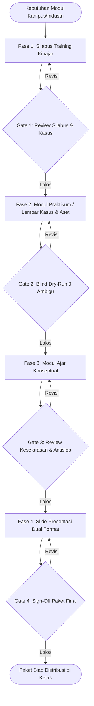

# STANDAR OPERASIONAL PROSEDUR (SOP) WORKFLOW PEMBUATAN MATERI TRAINING KIHAJAR ACADEMY
## Panduan Operasional Pembuatan Silabus, Modul Praktikum/Kasus, Modul Ajar, dan Slide Presentasi
**Spesialisasi Pelatihan AI Terapan untuk Institusi Pendidikan (Dosen & Mahasiswa: Tech & Non-Tech)**
*Berbasis Ekosistem Google AI (Gemini, NotebookLM, Google Flow, Antigravity) & Model Tim Lean AI-Assisted*

---

## 1. PENDAHULUAN & KONTEKS PROGRAM KIHAJAR ACADEMY

### 1.1 Profil dan Semangat Program Kihajar
**Kihajar Academy** adalah inisiatif pelatihan kecerdasan artifisial (AI) terapan untuk institusi pendidikan tinggi (perguruan tinggi/vokasi) yang diselenggarakan bersama **Eudeka (Mitra Resmi Google for Education & Google Professional Development Partner)**.

Program ini dirancang langsung bersama praktisi industri dengan prinsip **"Pilih Modul Praktis Berbasis Studi Kasus Riil"**:
1. **Untuk Dosen Peneliti**: Mengoptimalkan Google AI untuk mengakselerasi siklus riset, sintesis literatur ilmiah, pengolahan data statistik, penulisan manuskrip jurnal bereputasi (Scopus/SINTA), pemenuhan Beban Kerja Dosen (BKD), serta pencapaian **IKU 5** (Hasil Riset Dosen Dimanfaatkan Masyarakat/Mendapat Rekognisi Internasional).
2. **Untuk Mahasiswa (Tech & Non-Tech)**: Menguasai keterampilan AI terapan untuk melipatgandakan produktivitas akademik, membangun portofolio proyek terverifikasi yang lolos seleksi kerja modern (sistem ATS), menyiapkan keterampilan wirausaha mandiri (*solopreneurship*), serta mendukung **IKU 1** (Kesiapan Kerja Lulusan) dan **IKU 4** (Praktisi Industri Mengajar di Kampus).

### 1.2 Kebijakan Asesmen: Tanpa Ujian Teori, Berbasis Portofolio Nyata
Pelatihan Kihajar Academy **tidak menggunakan ujian pilihan ganda atau kuis hafalan teori** untuk pemberian sertifikat. Kelulusan dan penerbitan sertifikat digital terverifikasi didasarkan murni pada **Portofolio Karya Fungsional (*Functional Deliverables*)** yang dihasilkan secara nyata selama pelatihan.

Oleh karena itu, workflow ini berfokus penuh pada **rekayasa materi training yang menghasilkan bukti karya langsung di setiap sesi**.

---

## 2. ARSITEKTUR 3 TRACK & MODULAR TOOLKIT GOOGLE AI

### 2.1 Matriks 3 Track Utama Kihajar

```
                       [KIHAJAR ACADEMY]
                               |
       +-----------------------+-----------------------+
       |                                               |
[TRACK 1: DOSEN PENELITI]                     [MAHASISWA KAMPUS]
* Fokus: Riset & Publikasi                             |
* IKU 5 & Portofolio BKD              +----------------+----------------+
                                      |                                 |
                          [TRACK 2: NON-TECH]               [TRACK 3: TECH]
                          * Produktivitas & Karir           * Agentic AI & Coding
                          * Portofolio ATS & Solopreneur    * Antigravity & Google Flow
                          * IKU 1 & SKPI                    * IKU 1 & Inovasi IT
```

| Parameter | Track 1: Dosen Peneliti | Track 2: Mahasiswa Non-Tech | Track 3: Mahasiswa Tech |
| :--- | :--- | :--- | :--- |
| **Audiens Sasaran** | Dosen tetap, peneliti kampus, pengelola jurnal, pimpinan LPPM | Mahasiswa aktif FISIP, FEB, FIB, Hukum, Komunikasi, Manajemen | Mahasiswa Teknik Informatika, Sistem Informasi, Ilmu Komputer, Sains Data |
| **Fokus Sasaran Kinerja** | Akselerasi publikasi Scopus/SINTA, efisiensi waktu tinjauan pustaka, kepatuhan etika AI | Kesiapan rekrutmen kerja (CV ATS), portofolio tugas akhir, validasi bisnis solopreneur | Penguasaan Autonomous Agentic AI, pair-programming cerdas, rekayasa pipeline AI |
| **Luaran Karya (*Deliverables*)** | **Research Dossier**: Sintesis pustaka, draf manuskrip bab 1-3, dan pernyataan etika AI Scopus | **Career/Business Dossier**: CV ramah ATS, portofolio proyek industri, canvas model bisnis | **Agentic AI Repository**: Repositori GitHub berjalan, skrip automasi flow, deployment bot |
| **Dukungan Indikator Kinerja** | IKU 5 (Riset Terindeks) & Portofolio BKD | IKU 1 (Kesiapan Kerja) & SKPI | IKU 1 (Talenta Digital) & IKU 4 (Praktisi Tech) |

---

### 2.2 Modular Toolkit Google AI ("Lego Bricks Architecture")
Setiap modul materi dirancang secara lepas-pasang (*modular*). Instruktur bebas mengombinasikan perangkat Google AI berikut sesuai kebutuhan kampus mitra:

1. **Google NotebookLM**:
   - *Fungsi Utama*: Sintesis literatur ilmiah, kajian dokumen PDF tanpa halusinasi (*source-grounded AI*), ekstraksi *research gap*, dan pembuatan audio overview riset.
   - *Pengguna Ideal*: Dosen Peneliti & Mahasiswa (Tinjauan Pustaka & Kajian Kasus Bisnis).
2. **Google Gemini (Gemini Advanced & Gemini in Google Workspace for Education)**:
   - *Fungsi Utama*: *Help Me Write* di Google Docs (draf naskah/proposal), *Help Me Analyze* di Google Sheets (analisis regresi & grafik data), formulasi prompt pemecahan masalah industri, optimasi profil karir/ATS.
   - *Pengguna Ideal*: Dosen, Mahasiswa Non-Tech & Tech.
3. **Google Antigravity**:
   - *Fungsi Utama*: Platform agentic AI coding terdepan, arsitektur multi-agent, otomatisasi refactoring, implementasi kode perangkat lunak, dan pair-programming cerdas.
   - *Pengguna Ideal*: Mahasiswa Tech (Software Engineering, Data Science).
4. **Google Flow / Workflows & AppSheet / Agent Builder**:
   - *Fungsi Utama*: Otomasi alur kerja tanpa/rendah kode (*low-code automation*), integrasi multi-aplikasi, dan orkestrasi alur dokumen cerdas.
   - *Pengguna Ideal*: Mahasiswa Tech & Mahasiswa Bisnis/Operasional Lanjutan.
5. **Google Workspace for Education (GWFE) Infrastructure**:
   - *Fungsi Utama*: Keamanan data riset kampus, Originality Reports (deteksi plagiarisme & AI tanpa batas), jaminan zero-model-training (ISO/IEC 42001 & UU PDP).

---

## 3. FORMAT PENGHANTARAN MATERI (DUAL DELIVERY MODEL)

Setiap topik pelatihan yang dikembangkan wajib memiliki **dua varian paket penghantaran**:

```
[Topik Pelatihan Kihajar]
       |
       +---> [Varian A: Format Kilat - Seminar & Roadshow Kampus]
       |     * Durasi: 90 - 120 Menit (Interaktif)
       |     * Porsi: 40% Mindset & Urgensi, 40% Live Demo Industri, 20% Latihan Mikro
       |     * Output: Peta Jalan Kesiapan AI & 1 Aset Quick-Win (misal: Prompt Template / Profil ATS)
       |
       +---> [Varian B: Format Mendalam - Lokakarya Praktis 1 Hari / Seri 4 Sesi]
             * Durasi: 1 Hari Penuh (6 Jam) ATAU 4 Sesi @ 2-3 Jam
             * Porsi: 20% Konsep Inti, 70% Hands-On Lab Terbimbing, 10% Debrief Portofolio
             * Output: Portofolio Proyek Terapan Lengkap Siap Verifikasi Sertifikat
```

---

## 4. URUTAN HANDOFF KERJA 4 DOKUMEN (BACKWARD HANDOFF CHAIN)

Untuk menghasilkan materi yang aplikatif dan bebas dari teori mengambang, tim pengembang wajib menyusun dokumen dengan urutan berikut:



---

## 5. FASE 1: WORKFLOW PEMBUATAN SILABUS TRAINING KIHAJAR

### 5.1 Prosedur Operasional
1. **Analisis Profil Peserta & Penetapan Track**: Tentukan apakah modul ditujukan untuk Dosen, Mahasiswa Non-Tech, atau Mahasiswa Tech.
2. **Kunci Luaran Portofolio (Backward Assessment)**: Tetapkan produk akhir apa yang harus dihasilkan peserta sebelum menulis materi (misal: naskah bab 1-3 jurnal untuk dosen; CV ATS + portofolio untuk mahasiswa).
3. **Formulasi Capaian SMART dengan Taksonomi Bloom**:
   - Ranah Kognitif: gunakan kata kerja operasional (*menganalisis, mengevaluasi, merumuskan*).
   - Ranah Psikomotor: gunakan aksi teknis (*mengonfigurasi, merekayasa prompt, menjalankan pipeline, memvalidasi sitasi*).
   - Ranah Afektif: tekankan integritas akademik (*etika AI, perlindungan data pribadi, deklarasi transparansi*).
4. **Matriks Sesi & Dual Duration Chunking**: Susun jadwal sesi ke dalam blok 10-15 menit (paparan singkat diselingi live demo dan eksekusi instruksi).

### 5.2 Quality Gate 1: Kriteria Kelulusan Silabus
- [ ] Profil audiens (Dosen / Mhs Non-Tech / Mhs Tech) terdefinisi jelas.
- [ ] Luaran portofolio nyata (*functional deliverable*) telah dirumuskan secara eksplisit di awal dokumen.
- [ ] Pemilihan alat Google AI relevan dengan kasus industri yang dipecahkan.
- [ ] Tersedia pembagian alokasi waktu untuk Format Kilat (90-120m) dan Format Mendalam (4 sesi/1 hari).
- [ ] Telah disetujui oleh Peer Reviewer melalui komentar Google Docs.

### 5.3 AI Co-Pilot Prompt: Silabus Maker Kihajar
```markdown
Anda adalah Master Instructional Designer di Kihajar Academy (spesialisasi Google AI untuk Pendidikan Tinggi).

Tugas Anda: Susun draf Silabus Training modular berdasarkan spesifikasi:
- Track: [Dosen Peneliti / Mahasiswa Non-Tech / Mahasiswa Tech]
- Topik Modul: [Contoh: Sintesis Pustaka & Research Gap dengan NotebookLM / Agentic AI dengan Antigravity]
- Alat Google AI: [Pilih kombinasi: Gemini / NotebookLM / Flow / Antigravity]
- Dukungan IKU: [IKU 5 Dosen / IKU 1 & 4 Mahasiswa]

Format Output:
1. Profil Modul & Target Kinerja Nyata (Backward Design).
2. Capaian Pembelajaran SMART (Kognitif, Psikomotor, Afektif/Etika AI).
3. Spesifikasi Portofolio Akhir (Tanpa ujian, murni artefak karya).
4. Matriks Sesi: Sediakan 2 tabel jadwal: (A) Versi Seminar Kilat (90-120 Menit) dan (B) Versi Lokakarya Mendalam (1 Hari / 4 Sesi).
```

---

## 6. FASE 2: WORKFLOW PEMBUATAN MODUL PRAKTIKUM / KASUS KIHAJAR

### 6.1 Prosedur Rekayasa Praktikum (Diátaxis & Skillable Standards)
1. **Penetapan Mode Diátaxis**:
   - *Mode Tutorial (Guided Lab)*: Dipakai pada 30% awal sesi untuk familiarisasi antarmuka Google AI (satu jalur lurus, bebas error).
   - *Mode How-To / Case Challenge*: Dipakai pada 70% sisa sesi untuk menyelesaikan masalah riil (misal: membersihkan data mentah survei riset di Sheets atau membangun proyek web agentic di Antigravity).
2. **Penyediaan Aset Lab Lengkap**:
   - *Starter Assets*: PDF artikel mentah untuk NotebookLM, template spreadsheet kuesioner, atau starter code repo untuk Antigravity.
   - *Solution Assets*: Hasil akhir yang sudah tervalidasi 100% benar.
   - *Checkpoints*: File pemulihan di setiap exercise agar peserta yang tertinggal bisa langsung melompat ke latihan berikutnya.
3. **Disiplin Redaksional Mikro**:
   - Terapkan hierarki: **Exercise (H1) -> Task (H2) -> Numbered Steps (1., 2., dst)**.
   - Terapkan formula **Where, What, Why** dalam **tepat satu kalimat per langkah**.
   - Huruf **Bold** hanya untuk tombol/elemen antarmuka Google AI.
   - Seluruh teks prompt, skrip, dan instruksi disediakan dalam format kode siap salin (*copy-paste friendly*).
4. **Blind Dry-Run Testing**: Diuji secara mandiri oleh Peer Reviewer di akun Google bersih tanpa pendampingan pembuat modul.

### 6.2 Quality Gate 2: Kriteria Kelulusan Modul Praktikum
- [ ] Aset awal (*starter assets*) dan kunci hasil (*solution assets*) tersedia lengkap di Google Drive/GitHub.
- [ ] Instruksi langkah menggunakan formula *Where, What, Why* (1 kalimat per nomor).
- [ ] Telah lulus uji coba eksekusi buta (*blind dry-run*) dengan 0 langkah ambigu.
- [ ] Dilengkapi Tabel Troubleshooting (Gejala Error -> Kemungkinan Penyebab -> Solusi Perbaikan).

### 6.3 AI Co-Pilot Prompt: Lab Engineer Kihajar
```markdown
Anda adalah Lead Lab Engineer di Kihajar Academy yang menguasai standar Skillable Instructions dan Diátaxis Framework.

Tugas Anda: Buat draf Panduan Praktikum (Hands-On Lab Guide) untuk studi kasus:
- Topik Praktikum: [Isi Topik]
- Track & Audiens: [Dosen Peneliti / Mhs Non-Tech / Mhs Tech]
- Alat Google AI yang dipakai: [Sebutkan tools spesifik, misal: NotebookLM + Gemini in Docs]
- Hasil Akhir: [Portofolio nyata yang harus selesai di akhir lab]

Aturan Penulisan:
1. Bagi ke dalam hierarki: Exercise -> Task -> Numbered Steps.
2. Tulis setiap langkah dalam 1 kalimat dengan urutan: Where (lokasi di layar), What (tindakan spesifik), Why (tujuan tindakan).
3. Bold HANYA elemen tombol/menu antarmuka Google AI. Sediakan semua prompt AI dalam blok teks siap salin.
4. Buat draf Tabel Troubleshooting berisi minimal 3 kendala umum (misal: limit kuota prompt, file PDF tidak terbaca, formatting hilang).
```

---

## 7. FASE 3: WORKFLOW PEMBUATAN MODUL AJAR TRAINING KIHAJAR

### 7.1 Prosedur Penulisan Konseptual (Gagné 6-Bagian & Merrill)
1. **Beban Kognitif (Cognitive Load)**: Pecah narasi teori menjadi blok bacaan 10-15 menit. Integrasikan tangkapan layar antarmuka Google AI tepat di bawah teks penjelas (*eliminasi split-attention*).
2. **Struktur 6 Bagian Wajib per Bab**:
   - *Bagian 1: Kasus Nyata & Sasaran Bab* (Mulai dengan urgensi industri/akademik).
   - *Bagian 2: Aktivasi Konsep* (Analogi akrab, misal: mengibaratkan NotebookLM sebagai asisten peneliti pribadi yang hanya membaca buku yang diberikan).
   - *Bagian 3: Konsep Inti* (Prinsip kerja LLM, grounding data, zero-shot/few-shot prompting).
   - *Bagian 4: Worked Examples & Non-Examples* (Tunjukkan 1 prompt sukses lengkap dengan hasilnya, dan tunjukkan 1 prompt buruk yang menghasilkan halusinasi beserta cara memperbaikinya).
   - *Bagian 5: Latihan Refleksi Mikro* (Tantangan berpikir cepat sebelum masuk lab).
   - *Bagian 6: Rangkuman & Jembatan ke Praktikum* (Poin kunci dan perintah beralih ke Modul Praktikum).
3. **Penyuntingan Antislop**: Gunakan bahasa Indonesia baku, profesional, kalimat aktif, dan bersihkan dari kata-kata klise AI hiperbolis (*merevolusi, membuka jendela masa depan, menyelami lebih dalam*).

### 7.2 Quality Gate 3: Kriteria Kelulusan Modul Ajar
- [ ] Memenuhi struktur 6 bagian (Gagné & Merrill) secara konsisten.
- [ ] Menyajikan perbandingan *Worked Examples* (prompt efektif) dan *Non-Examples* (prompt halusinasi/buruk).
- [ ] Seluruh konsep mendukung langsung tugas eksekusi di Modul Praktikum.
- [ ] Lolos uji keterbacaan bahasa lugas (*antislop check*).

### 7.3 AI Co-Pilot Prompt: Instructional Drafter Kihajar
```markdown
Anda adalah Senior Instructional Writer di Kihajar Academy.

Tugas Anda: Tulis naskah lengkap 1 bab Modul Ajar Konseptual:
- Judul Bab: [Isi Judul]
- Track: [Dosen / Mhs Non-Tech / Mhs Tech]
- Alat Google AI: [Alat yang dibahas]
- Praktikum Terkait: [Sebutkan tugas lab di Modul Praktikum yang didukung oleh bab ini]

Format Alur 6 Bagian:
1. Masalah Riil Kampus/Industri & Sasaran Pembelajaran
2. Aktivasi Konsep (Gunakan analogi konkret dunia nyata)
3. Pemaparan Konsep Inti (Prinsip kerja & logika sistem)
4. Worked Example (Studi kasus prompt ideal) & Non-Example (Contoh kesalahan fatal halusinasi)
5. Latihan Refleksi Mikro
6. Kesimpulan & Jembatan Praktikum

Gaya Bahasa: Bahasa Indonesia yang lugas, profesional, kalimat aktif, dan bebas jargon klise AI.
```

---

## 8. FASE 4: WORKFLOW PEMBUATAN SLIDE PRESENTASI DUAL FORMAT

### 8.1 Prosedur Perancangan Visual (Mayer Multimedia Principles)
1. **Rule of One Idea Per Slide**: Hindari menumpuk paragraf panjang di slide. Gunakan slide murni sebagai panduan visual kelas.
2. **Struktur Deck Dual Format**:
   - **Varian Kilat (Seminar 90-120m)**: 15-20 slide (fokus pada urgensi disrupsi AI, studi kasus industri, live demo prompt interaktif, dan ajakan aksi).
   - **Varian Mendalam (Lokakarya 1 Hari)**: 30-40 slide (terbagi dalam modul-modul kecil yang diselingi *Slide Transisi Praktikum*).
3. **Slide Transisi Praktikum (Lab Prompt Slide)**: Wajib menyertakan slide khusus penanda praktikum yang menyebutkan nomor *Exercise*, durasi lab, dan tautan repositori aset.
4. **Presenter Notes Lengkap**: Setiap slide wajib memuat *talking points*, alokasi waktu menit, dan pertanyaan pancingan interaktif untuk fasilitator.

### 8.2 Quality Gate 4: Kriteria Kelulusan Slide Deck
- [ ] Rasio layar 16:9 dengan kontras warna modern dan nyaman dibaca.
- [ ] Tersedia versi ringkas (Roadshow) dan versi lokakarya (Workshop).
- [ ] Tersedia slide penanda transisi praktikum (*Lab Prompt Slide*).
- [ ] 100% slide memiliki Presenter Notes berisi panduan lisan instruktur.

### 8.3 AI Co-Pilot Prompt: Slide Outliner Kihajar
```markdown
Anda adalah Presentation Designer di Kihajar Academy.

Tugas Anda: Rancang outline slide presentasi Google Slides (16:9):
- Topik: [Isi Topik]
- Format: [Versi Seminar Kilat 90 Menit ATAU Versi Lokakarya Mendalam 1 Hari]
- Rujukan: [Rangkum dari Modul Ajar dan Modul Praktikum]

Output per Slide:
1. Judul Slide (Deklaratif & menarik)
2. Komponen Visual (Tata letak kartu, diagram arsitektur, atau tangkapan layar)
3. Bullet Points (Maksimal 3-4 butir poin ringkas)
4. Presenter Notes (Naskah narasi lisan fasilitator, alokasi menit, dan pertanyaan pemantik audiens)
```

---

## 9. TATA KELOLA PENYIMPANAN, VERSIONING, & DISTRIBUSI

### 9.1 Standar Struktur Direktori Google Drive Kihajar
```
[Google Drive] /Kihajar Academy - Materi/
│
├── 01_Track_Dosen_Peneliti/
│   ├── [Kode_Modul] - [Nama Modul Riset]/
│   │   ├── Silabus - v1.0.0.gdoc
│   │   ├── Modul_Praktikum - v1.0.0.gdoc
│   │   ├── Modul_Ajar - v1.0.0.gdoc
│   │   ├── Slides_Roadshow_90m - v1.0.0.gslides
│   │   ├── Slides_Workshop_1Day - v1.0.0.gslides
│   │   └── Aset_Praktikum/ (PDF dummy riset, template sheets)
│
├── 02_Track_Mahasiswa_NonTech/
│   └── ... (Struktur serupa: CV ATS, studi kasus bisnis)
│
├── 03_Track_Mahasiswa_Tech/
│   └── ... (Struktur serupa: repo Antigravity, skrip flow)
│
└── 00_Template_Dan_Panduan/
    ├── Template_Silabus_Kihajar.gdoc
    ├── Template_Lab_Guide_Kihajar.gdoc
    └── Checklist_Continuous_Peer_Review.gdoc
```

### 9.2 Semantic Versioning Dokumen
- Format: `[Nama Dokumen] - v[Mayor].[Minor].[Patch]`
- Contoh: `Modul_Praktikum_NotebookLM_Dosen - v1.0.0`
- Pembaruan versi dilakukan jika:
  - Ada perubahan antarmuka atau fitur pada Google AI (Patch/Minor).
  - Ada perubahan kurikulum atau penambahan studi kasus baru (Major).

---

## 10. FORMULIR RINGKAS: CHECKLIST KELAYAKAN MATERI KIHAJAR (SIGN-OFF)

```markdown
Nama Modul Pelatihan : ____________________________________________
Track Sasaran        : [ ] Dosen Peneliti  [ ] Mhs Non-Tech  [ ] Mhs Tech
Tools Google AI      : [ ] Gemini  [ ] NotebookLM  [ ] Flow  [ ] Antigravity
Lead Trainer (Author): ____________________________________________
Peer Reviewer (QA)   : ____________________________________________

[ ] GATE 1 - SILABUS TRAINING
    [ ] Sasaran kinerja terukur & selaras dengan IKU (1, 4, atau 5)
    [ ] Portofolio akhir fungsional ditetapkan (tanpa ujian teori)
    [ ] Tersedia opsi jadwal: Format Kilat (90m) & Format Mendalam (1 Hari)
    Status: APPROVED / REVISE (Paraf Reviewer: _____)

[ ] GATE 2 - MODUL PRAKTIKUM / KASUS
    [ ] Starter assets & solution assets teruji di Drive/GitHub
    [ ] Format langkah Where, What, Why & 1 kalimat per nomor
    [ ] Lolos Blind Dry-Run (0 langkah ambigu)
    [ ] Tabel Troubleshooting lengkap
    Status: APPROVED / REVISE (Paraf Reviewer: _____)

[ ] GATE 3 - MODUL AJAR KONSEPTUAL
    [ ] Struktur 6 bagian Gagné & Merrill lengkap
    [ ] Worked Examples & Non-Examples disertakan
    [ ] Bebas split-attention effect
    [ ] Gaya bahasa lugas & bebas klise AI (Antislop passed)
    Status: APPROVED / REVISE (Paraf Reviewer: _____)

[ ] GATE 4 - SLIDE PRESENTASI DUAL FORMAT
    [ ] Tersedia versi Roadshow 90m dan versi Workshop 1 Hari
    [ ] Rule of One Idea per Slide dipatuhi
    [ ] Slide transisi praktikum tersedia
    [ ] Presenter Notes lengkap dengan skrip & timing
    Status: APPROVED / REVISE (Paraf Reviewer: _____)

Pengesahan Final Paket Materi:
Lead Trainer: ____________________     Peer Reviewer: ____________________
```

---
*Dokumen ini merupakan SOP resmi pengembangan kurikulum dan materi pelatihan Kihajar Academy.*
